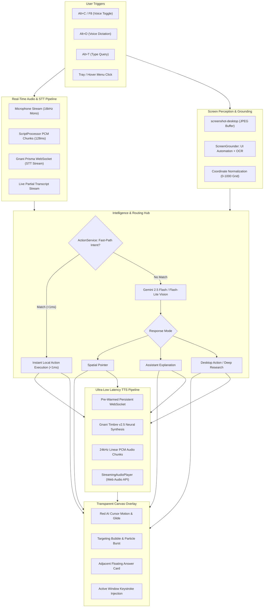

# Pointy AI: Complete Product Specification, Technical Pipeline & Architecture Guide

---

## 1. Executive Summary & Vision

**Pointy AI** is an intelligent, screen-aware spatial AI companion and autonomous desktop assistant. Unlike traditional chatbot windows that confine AI to a rectangular text box, Pointy lives directly on the user's desktop as a lightweight, transparent overlay. It combines **computer vision**, **real-time speech recognition (STT)**, **low-latency neural speech synthesis (TTS)**, and **OS-level automation** to see what you see, point directly at what you are looking for, answer questions aloud, type into your active applications, and automate complex workflows.

```
┌────────────────────────────────────────────────────────────────────────┐
│                        POINTY AI DESKTOP UNIVERSE                      │
├──────────────────────────────────┬─────────────────────────────────────┤
│  Transparent Spatial Overlay     │  Standalone Desktop App (Electron)  │
│  - Red AI Companion Cursor (26px)│  - Chat History & Full-Text Search  │
│  - Spatial Pointing & Particles  │  - Pinned & Recent Conversations    │
│  - Adjacent Floating Answer Card │  - Two-Way Real-time Sync           │
│  - Research Dossier & Dictation  │  - API Keys & Model Configuration   │
└──────────────────────────────────┴─────────────────────────────────────┘
```

---

## 2. End-to-End System Architecture & Pipeline

Pointy AI operates as a unified pipeline connecting native OS events, audio streams, computer vision, multimodal reasoning, and low-latency audio playback.



### Detailed Pipeline Stages

#### Stage 1: Activation & Input Ingestion
- **Voice Toggle (<kbd>Alt+C</kbd> / <kbd>F8</kbd>)**: User taps <kbd>Alt+C</kbd> once. The low-level `node-global-key-listener` and Electron `globalShortcut` catch the keypress immediately. Pointy pops out the Red AI cursor, begins mouse tracking, and opens a live microphone session. Tapping <kbd>Alt+C</kbd> again terminates speech with 0ms delay.
- **Voice Dictation (<kbd>Alt+D</kbd>)**: Activates live voice typing at the user's cursor position.
- **Silent Typing (<kbd>Alt+T</kbd>)**: Focuses a floating text box for silent prompts without speaking aloud.

#### Stage 2: Streaming Audio & STT (Speech-to-Text)
- High-fidelity 16kHz mono audio is recorded via `navigator.mediaDevices.getUserMedia`.
- A Web Audio `ScriptProcessor` extracts raw 16-bit linear PCM frames every 128ms (2048 samples) and streams them via IPC to `gnaniService.createLiveStreamingSession`.
- Chunks stream over a pre-warmed WebSocket (`wss://api.vachana.ai/stt/v3/stream`).
- Partial transcripts stream back to the UI in real-time. When the user stops speaking (or presses <kbd>Alt+C</kbd>), a 500ms silence token triggers an instant final transcript.

#### Stage 3: Vision Perception & Coordinate Grounding
- While speech is transcribing, `screenshot-desktop` captures a high-resolution screenshot buffer.
- `ScreenGrounder` inspects Windows UI Automation (UIA) accessibility trees and uses Windows Media OCR as fallback.
- Coordinates are normalized to a `0..1000` integer space, scaling across 100%, 125%, 150%, and 200% Windows display DPI settings.

#### Stage 4: Multimodal Reasoning & Intent Routing
- **Fast-Path Engine (`ActionService`)**: Checks if the query matches local system control (volume, brightness, app launching, time/date, media keys). If matched, it executes in <1ms without calling the cloud LLM.
- **Gemini 2.5 Flash Vision**: If not local, Gemini processes the screenshot, conversation history, and user question, returning a structured JSON response specifying:
  - `mode`: `"pointer"` | `"assistant"` | `"action"`
  - `reply`: Concise or comprehensive speech text
  - `reply_lang`: Language code (`en-IN`, `hi-IN`, `te-IN`, `ta-IN`, etc.)
  - `steps`: Array of bounding boxes `[ymin, xmin, ymax, xmax]`
  - `detailed_explanation`: Rich markdown breakdown

#### Stage 5: Streaming Voice Synthesis (TTS)
- Pointy maintains a standing, warm WebSocket connection (`wss://api.vachana.ai/api/v1/tts`) with 25s ping keep-alives.
- Time-to-First-Audio (TTFA) is **~160ms**.
- Audio chunks stream over IPC directly into `StreamingAudioPlayer`, which queues scheduled audio buffers in the Web Audio API context (`sampleRate: 24000`) for seamless, artifact-free playback.
- An in-memory cache (`pointy_tts_cache.json`) provides **1ms instant responses** for standard phrases.

#### Stage 6: Spatial Overlay Presentation & Keystroke Injection
- Pointy glides across the screen along a cubic-bezier path to the target coordinates.
- Spawns animated particle bursts on arrival.
- Displays an illuminated targeting ring and opens the Floating Answer Card beside Pointy's position.
- In Dictation mode, Pointy uses Windows keystroke injection (PowerShell `[System.Windows.Forms.SendKeys]`) to type text directly into the focused window.

---

## 3. Comprehensive Feature Catalog

### 3.1. Spatial Visual Pointing & Companion Mode
- **Mouse Following Companion**: When standby, Pointy's signature 26px Red Cursor flows smoothly alongside the user's cursor (`+16px, +14px` offset), leaving the native OS cursor unobstructed.
- **Pinpoint Guidance**: When asked "Where is...", Pointy computes the exact bounding box and flies to the element, pulsing with a targeting circle.
- **Smart Pointing Guard**: Pointy only flies across the screen for spatial queries. For informational questions ("what time is it", "explain this code"), it remains anchored beside your cursor.
- **Kinetic Glide & Arrival Particles**: Dynamic physics-based glide with 12-particle explosive burst upon arriving at target UI elements.

### 3.2. Hands-Free Voice Interaction (Toggle Mode)
- **Alt+C Toggle**: Press <kbd>Alt+C</kbd> once to talk; press <kbd>Alt+C</kbd> again to stop. No awkward push-and-hold required.
- **Natural Breathing Allowance**: A 4.0s silence threshold prevents mid-sentence cutoffs when pausing to gather thoughts.
- **Master Instant Dismissal (<kbd>Esc</kbd>)**: Pressing <kbd>Esc</kbd> anywhere on Windows instantly terminates speech audio, hides floating cards, cancels pending network requests, and returns Pointy to idle companion mode.

### 3.3. Voice Dictation to Active Window (<kbd>Alt+D</kbd>)
- **Direct Keystroke Injection**: Dictate in real time into VS Code, Chrome, Word, Notepad, Slack, or any active terminal.
- **Floating Dictation Pill**: Real-time transcript pill follows the cursor showing spoken words as you speak.
- **Automatic Formatting**: Handles capitalization and punctuation before injecting text.

### 3.4. Adjacent Floating Answer Card & Multi-Turn Chat
- **Adaptive Layout**: Compact view for short answers; expands automatically for code and multi-paragraph explanations.
- **Multi-Turn Chat**: Ask follow-up questions directly using the card's integrated text box or microphone button.
- **Interactive Controls**:
  - `New Chat`: Clears current session and starts fresh.
  - `Code Copy`: One-click copy for syntax-highlighted code snippets.
  - `Manual Resizing`: Drag handles along the borders with persistent sizing.
  - `Reading Guard`: Card remains open while reading or hovering; auto-dismisses 5.5s after speech completes.

### 3.5. Multi-Lingual Speech Engine (Gnani Timbre v2.5)
Pointy dynamically detects language and switches to dedicated neural voices:
- **English (`en-IN` / `en-US`)**: *Aarohi*
- **Hindi (`hi-IN`)**: *Nalini*
- **Telugu (`te-IN`)**: *Devika*
- **Tamil (`ta-IN`)**: *Kaveri*
- **Kannada (`kn-IN`)**: *Chitra*
- **Bengali (`bn-IN`)**: *Radhika*
- **Marathi (`mr-IN`)**: *Bhavna*

### 3.6. Fast-Path Desktop Automation (<1ms Response)
Local execution without LLM latency for:
- **System Volume**: "Set volume to 70", "increase volume by 20", "mute audio".
- **Time & Date**: "What time is it?", "what day is today?".
- **App Launching**: "Open Notepad", "open Brave", "open Antigravity IDE", "open Calculator".
- **Browser Profiles**: "Open Chrome from student account", "open Brave work profile".
- **Media Controls**: Next track, pause, play on Spotify, YouTube, or Apple Music.

### 3.7. Autonomous Deep Research & Executive Dossier
- Triggered by requests like *"Do a detailed research on quantum computing in Claude"*.
- Pointy launches the target desktop app, formulates an in-depth 5-part research prompt, types it in, and executes it.
- Displays a floating **Research Progress Capsule** with live elapsed time while you continue working.
- On completion, plays an audio notification and presents the **Research Dossier Card** with an executive summary, key findings, and full markdown report.

### 3.8. Standalone Desktop App & Two-Way Sync
- Traditional ChatGPT/Claude-style desktop window accessible from the tray icon.
- **Conversation Management**: Pinned chats, chronological recents, full-text conversation search.
- **Two-Way Synchronization**: Questions asked in the spatial overlay appear in the desktop app, and vice-versa.
- **Settings Panel**: Configure API keys (Gemini, Gnani) and switch between AI models.

---

## 4. Hotkeys & Shortcuts Reference Sheet

| Shortcut | Action | Description |
| :--- | :--- | :--- |
| <kbd>Alt + C</kbd> or <kbd>F8</kbd> | **Voice Toggle** | Tap once to talk; tap again to end speech and submit. |
| <kbd>Alt + D</kbd> | **Voice Dictation** | Types spoken words directly into the active application. |
| <kbd>Alt + T</kbd> | **Type Query** | Opens floating text prompt bar beside cursor. |
| <kbd>Esc</kbd> | **Instant Cancel** | Stops TTS audio, hides cards, and resets Pointy to standby. |
| <kbd>Ctrl + Space</kbd> | **Summon Voice** | Alternative voice summon shortcut. |

---

## 5. Verification & Production Checklist

- [x] **Time-to-First-Audio (TTFA)**: Benchmark verified at **~160ms** via persistent warm WebSocket.
- [x] **Audio Cache**: 25 common control responses hit local cache in **<1ms**.
- [x] **Fast-Path Engine**: Volume, time, and app launching execute locally without cloud API calls.
- [x] **Display Scaling**: Coordinate normalization validated on 100%, 125%, 150%, and 200% DPI.
- [x] **Multi-Turn Continuity**: Context preserved across consecutive follow-ups.
- [x] **Single-Instance Enforcement**: Electron lock prevents duplicate background instances.

